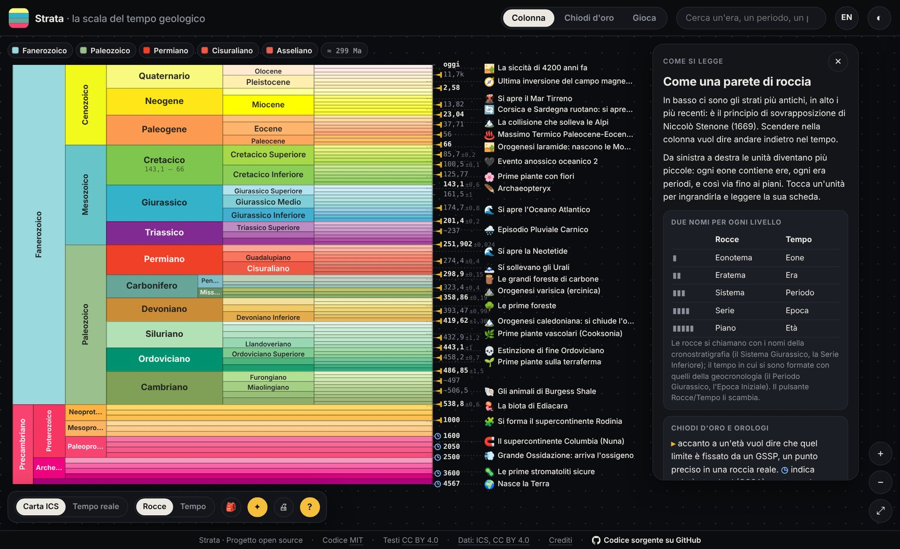
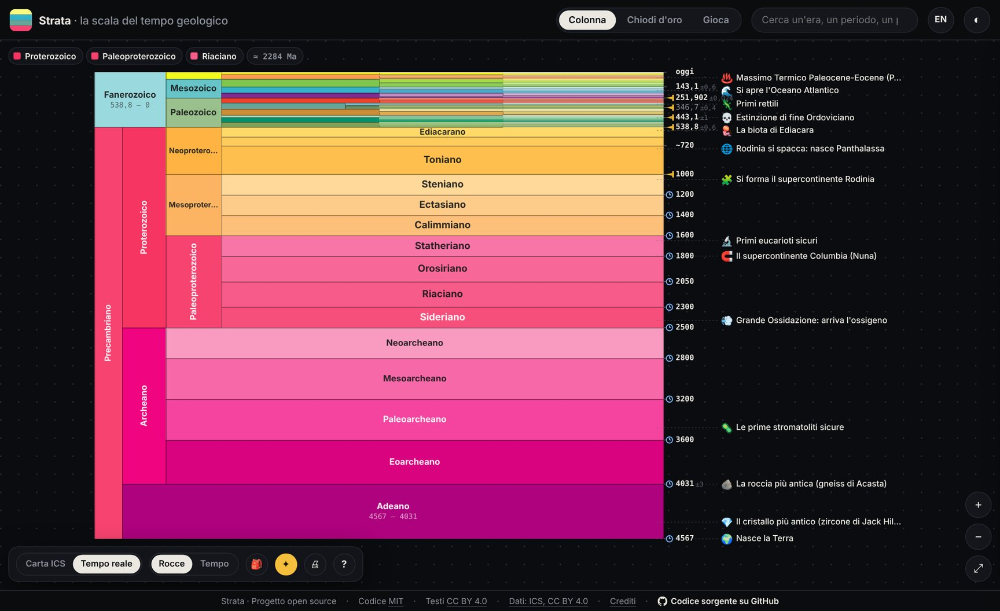
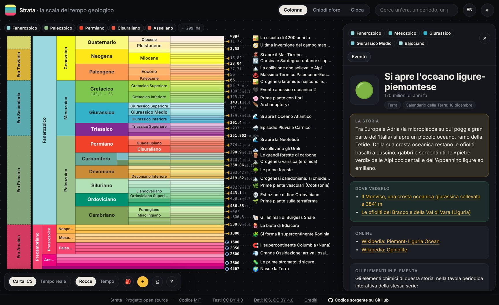
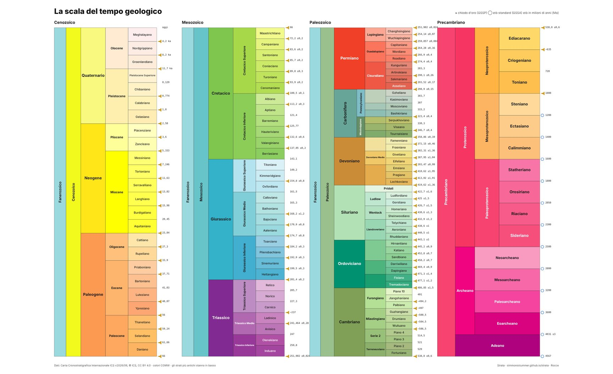
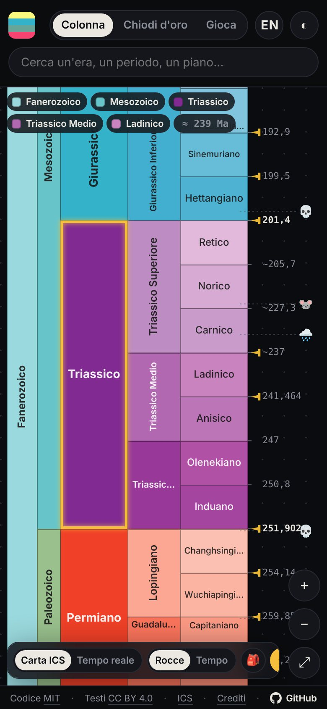

# Strata

**The geologic time scale to explore, study and play with — in English and Italian.**
**La scala del tempo geologico da esplorare, studiare e con cui giocare — in italiano e in inglese.**

### ▶ [Open Strata / Apri Strata — simmonsstummer.github.io/strata](https://simmonsstummer.github.io/strata/)

Strata runs in the browser, on desktop and phone, with nothing to install and no server-side code: it is made of static files only. It is a sister project of [Elementa](https://github.com/Simmonsstummer/elementa), the interactive periodic table.

[English](#english) · [Italiano](#italiano)



| | |
|---|---|
|  |  |
| **A card for every unit** / **Una scheda per ogni unità** | **Golden spike**: place, marker, rocks / **Chiodo d'oro**: luogo, segnale, rocce |
|  |  |
| **True time**: the Precambrian at its real length / **Tempo reale**: il Precambriano nella sua vera lunghezza | **Map** of all golden spikes / **Mappa** di tutti i chiodi d'oro |
|  |  |
| **Events** with places, books and links, and the **school eras** on the left / **Eventi** con luoghi, libri e link, e le **ere della scuola** a sinistra | **Printable chart** (A3/A4, SVG) / **Carta stampabile** (A3/A4, SVG) |

<p align="center">
  
  &nbsp;
  
</p>

---

## English

### What's inside

- **The column** – the International Chronostratigraphic Chart drawn as a rock face: the oldest units at the bottom (Hadean, Archean…), the youngest at the top (Quaternary). Eons, eras, periods, sub-periods, epochs and stages side by side, in the **official colours** (CGMW). Drag to move through time, zoom with the mouse wheel or by pinching; the closer you get, the more names appear. A breadcrumb at the top always tells you where you are.
- **Two scales** – *ICS chart* gives every stage the same height, like the official chart; *True time* is proportional to duration, all the way down to the 4,000-year stages of the Holocene. Switching animates between the two.
- **Two names** – *Rocks* uses the chronostratigraphic terms (System, Series, Stage; Lower/Upper Jurassic), *Time* the geochronologic ones (Period, Epoch, Age; Early/Late Jurassic).
- **Boundaries** – every boundary has its age and uncertainty; a golden nail marks the ones defined by a GSSP, a clock the ones defined by a standard age (GSSA).
- **Events** – 63 milestones of Earth's history on a lane next to the column: life (Cambrian explosion, first dinosaurs…), climate (Great Oxidation, Snowball Earth, PETM…), the mass extinctions and the story of plates, oceans and mountains (Rodinia, Panthalassa, Pangaea, the Tethys and the Ligurian-Piedmont ocean, the Caledonian, Variscan, Alpine and Himalayan orogenies, the birth of the Apennines and of the Tyrrhenian Sea, the Messinian crisis…). Tap one for a short story, **where to see it**, **books** and **online resources**, and links to the elements in [Elementa](https://simmonsstummer.github.io/elementa/).
- **The school eras** – the 🎒 button adds, next to the official column, the division taught in Italian primary schools (Archaic, Primary, Secondary, Tertiary, Quaternary era), dashed, with a card explaining what each one matches today.
- **Print and download** – the 🖨 button prints the whole chart on one A3 or A4 sheet in four panels, like the official ICS chart, or downloads it as a vector **SVG** for large prints; it can also print the open card.
- **Photos** – rocks, outcrops, fossils and golden-spike sections shown straight from Wikimedia Commons, **only with free licences** (CC0, public domain, CC BY, CC BY-SA, checked live on Commons), always with licence, author and source under the photo. See «Photos» below.
- **Works offline** – it can be installed on a phone or computer like an app (PWA) and then works without a connection.
- **A card for every unit**
  - *Overview*: origin of the name, what was happening, why the unit starts where it does, where to see these rocks in Italy, events, subdivisions, neighbours, its date on the «Earth calendar» (4.567 billion years squeezed into one year), official colour and the changes of the latest chart version.
  - *Boundary and type section*: the golden spike at the base — section, coordinates on a small map, the boundary signal (first appearance of a fossil, magnetic reversal, isotope event…), **the rocks of the section**, year of ratification and reference. Stages still without a GSSP show the candidate sections; Precambrian boundaries explain the chronometric ages.
- **Golden-spike map** – all the GSSPs on a world map, filterable by era: 82 ratified in 23 countries, 13 of them in Italy.
- **Games** – *Where does it go?* (tap the column where an event belongs), *Strata quiz* (names, colours, places, dates; always different), *Stack the layers* (the law of superposition, three levels), *Golden-spike hunt* (find the GSSP on the map).
- **Two languages** – Italian and English, switchable at any time with the IT/EN button (the first choice follows the browser language). Light and dark theme.

### Run it or put it on your website

Copy all the files into any folder of a web server, for example `public_html/strata/`. No PHP, database or build step is needed.

The app loads `data/strata.json` with `fetch`, so **it does not work by double-clicking `index.html`** (`file://`). To try it locally, start a small server in the folder:

```
python -m http.server 8000
```

and open http://localhost:8000.

The public version runs on GitHub Pages from the `main` branch: every push to `main` updates https://simmonsstummer.github.io/strata/.

Direct links: `#jurassic` opens the Jurassic (any unit id works: `#gelasian`, `#calabrian`, `#hadean`…), `#alps` or `#chicxulub` open an event, `#map` and `#play` open those views.

### Updating the time scale

The ICS publishes the chart as data in https://github.com/i-c-stratigraphy/chart. When a new version comes out:

```
pip install -r tools/requirements.txt
python tools/build.py path/to/chart.ttl
```

`tools/build.py` reads the units, ages, uncertainties, names and colours from `chart.ttl`, adds the texts from `tools/testi_unita.py`, `tools/testi_piani.py` and `tools/eventi.py`, and writes `data/strata.json`. It stops with an error if a unit has no text, so new or renamed units are not missed.

### Files

| File | Contents |
|---|---|
| `index.html`, `style.css` | page and style (light/dark theme) |
| `i18n.js` | interface texts, Italian and English |
| `core.js` | data helpers, number and age formatting |
| `column.js` | the stratigraphic column: canvas drawing, scales, zoom, hit testing |
| `panel.js` | the card of each unit |
| `map.js`, `world.js` | the golden-spike map and the world outline |
| `games.js` | the four games |
| `print.js` | printable chart (SVG) and card |
| `photos.js` | photos from Wikimedia Commons with live licence check, review page `#foto` |
| `sw.js`, `manifest.webmanifest`, `icons/` | offline use and installation (PWA) |
| `main.js` | startup, views, search, language and theme |
| `data/strata.json` | the generated data |
| `tools/` | build scripts and the source texts |
| `SOURCES.md` | all sources, with the reference of every golden spike (generated) |
| `docs/` | screenshots and the social preview image |

### Photos

The photos are shown **straight from Wikimedia Commons**, with nothing copied into the repository. `tools/immagini.py` lists what to illustrate (golden-spike sections, the rocks of each period — Italy first — and the events) with a few Commons searches for each. For every candidate file the browser reads **licence and author from the Commons API** and shows the photo only if the licence is **CC0, public domain, CC BY or CC BY-SA** and the author is named; the file must also mention the subject in its title or description. Under each photo: licence, author, link to the Commons page and to the licence, and a «wrong photo?» link that opens an issue. If Commons does not answer, or a file has been moved or deleted, simply no photo is shown.

To check the choices, open **`#foto`** (e.g. https://simmonsstummer.github.io/strata/#foto): for every subject it shows the free candidates; pick the right one or «none», press «Copy choices» and paste the result into `PIN` and `NONE` in `tools/immagini.py`, then run `tools/build.py`. Optionally `python tools/fetch_images.py` downloads local copies into `img/`, which are then used instead.

### Sources

- **Time scale** – International Commission on Stratigraphy, *International Chronostratigraphic Chart* v2026/06: data from [i-c-stratigraphy/chart](https://github.com/i-c-stratigraphy/chart), chart at [stratigraphy.org/chart](https://stratigraphy.org/chart). Cohen, K.M., Harper, D., Gibbard, P., Car, N. (2025), *The ICS International Chronostratigraphic Chart this decade*, Episodes 48: 105–115, [doi:10.18814/epiiugs/2025/025001](https://doi.org/10.18814/epiiugs/2025/025001).
- **Colours** – Commission for the Geological Map of the World (CGMW), as encoded in the ICS data.
- **Golden spikes** – ICS GSSP table, [stratigraphy.org/gssps](https://stratigraphy.org/gssps/), and the pages of the ICS subcommissions; every card cites the paper that ratified its GSSP. The full list, unit by unit, is in [`SOURCES.md`](SOURCES.md).
- **Map** – [Natural Earth](https://www.naturalearthdata.com) 1:50m, via [world-atlas](https://github.com/topojson/world-atlas).

### What's next

See [`ROADMAP.md`](ROADMAP.md).

### Found a mistake?

Every card has a «Report it» link that opens a GitHub issue already filled with the unit and the chart version. Corrections with a source are very welcome.

### How to cite

See [`CITATION.cff`](CITATION.cff) (GitHub shows a «Cite this repository» button). Please cite the ICS chart too.

### Licenses

- **Code**: MIT (`LICENSE`).
- **Texts written for Strata** (both languages): CC BY 4.0 (`LICENSE-CONTENT.md`).
- **Time-scale data**: © International Commission on Stratigraphy, CC BY 4.0 — chart v2026/06.
- **World map**: Natural Earth, public domain.

Full details in [`CREDITS.md`](CREDITS.md).

---

## Italiano

### Cosa contiene

- **La colonna** – la Carta Cronostratigrafica Internazionale disegnata come una parete di roccia: le unità più antiche in basso (Adeano, Archeano…), le più recenti in alto (Quaternario). Eoni, ere, periodi, sottoperiodi, epoche e piani affiancati, nei **colori ufficiali** (CGMW). Trascina per muoverti nel tempo, ingrandisci con la rotella o pizzicando: più ti avvicini, più nomi compaiono. In alto un «filo di Arianna» dice sempre dove ti trovi.
- **Due scale** – *Carta ICS* dà a ogni piano la stessa altezza, come la carta ufficiale; *Tempo reale* è proporzionale alla durata, fino ai piani di 4000 anni dell'Olocene. Il passaggio tra le due è animato.
- **Due nomi** – *Rocce* usa i termini della cronostratigrafia (Sistema, Serie, Piano; Giurassico Inferiore/Superiore), *Tempo* quelli della geocronologia (Periodo, Epoca, Età; Primo/Tardo Giurassico).
- **Limiti** – ogni limite ha la sua età con l'incertezza; un chiodo d'oro indica quelli definiti da un GSSP, un orologio quelli definiti da un'età standard (GSSA).
- **Eventi** – 63 tappe della storia della Terra in una corsia accanto alla colonna: la vita (esplosione cambriana, primi dinosauri…), il clima (Grande Ossidazione, Terra a palla di neve, PETM…), le estinzioni di massa e la storia di placche, oceani e montagne (Rodinia, Panthalassa, Pangea, la Tetide e l'oceano ligure-piemontese, le orogenesi caledoniana, varisica, alpina e himalayana, la nascita dell'Appennino e del Tirreno, la crisi messiniana…). Toccandone uno si apre un breve racconto con **dove vederlo**, **libri** e **risorse online**, e i collegamenti agli elementi in [Elementa](https://simmonsstummer.github.io/elementa/).
- **Le ere della scuola** – il pulsante 🎒 affianca alla colonna ufficiale la divisione che si studia alle elementari (Era Arcaica, Primaria, Secondaria, Terziaria, Quaternaria), tratteggiata, con una scheda che spiega a cosa corrisponde oggi ciascuna.
- **Stampa e download** – il pulsante 🖨 stampa tutta la carta su un foglio A3 o A4 in quattro pannelli, come la carta ufficiale ICS, oppure la scarica in **SVG** vettoriale per stamparla in grande; può stampare anche la scheda aperta.
- **Foto** – rocce, affioramenti, fossili e sezioni dei chiodi d'oro mostrati direttamente da Wikimedia Commons, **solo con licenze libere** (CC0, pubblico dominio, CC BY, CC BY-SA, verificate in tempo reale su Commons), sempre con licenza, autore e fonte sotto la foto. Vedi «Foto» più sotto.
- **Funziona offline** – si può installare sul telefono o sul computer come un'app (PWA) e poi funziona anche senza connessione.
- **Una scheda per ogni unità**
  - *Panoramica*: origine del nome, cosa succedeva, perché l'unità inizia proprio lì, dove vedere queste rocce in Italia, eventi, suddivisioni, unità vicine, la sua data sul «calendario della Terra» (4,567 miliardi di anni compressi in un anno), colore ufficiale e modifiche dell'ultima versione della carta.
  - *Limite e strato tipo*: il chiodo d'oro alla base — sezione, coordinate su una piccola mappa, il segnale del limite (prima comparsa di un fossile, inversione magnetica, evento isotopico…), **le rocce della sezione**, anno di ratifica e riferimento. I piani ancora senza GSSP mostrano le sezioni candidate; i limiti del Precambriano spiegano le età cronometriche.
- **Mappa dei chiodi d'oro** – tutti i GSSP su una mappa del mondo, filtrabili per era: 82 ratificati in 23 paesi, 13 in Italia.
- **Giochi** – *Dove lo metti?* (tocca la colonna dove va un evento), *Quiz degli strati* (nomi, colori, luoghi, date; sempre diversi), *Impila gli strati* (il principio di sovrapposizione, tre livelli), *Caccia al chiodo d'oro* (trova il GSSP sulla mappa).
- **Due lingue** – italiano e inglese, si cambia in ogni momento con il pulsante IT/EN (la prima scelta segue la lingua del browser). Tema chiaro e scuro.

### Provarla o metterla sul tuo sito

Copia tutti i file in una cartella qualsiasi di un server web, ad esempio `public_html/strata/`. Non servono PHP, database o passaggi di compilazione.

L'app carica `data/strata.json` con `fetch`, quindi **non funziona aprendo `index.html` con un doppio clic** (`file://`). Per provarla in locale avvia un piccolo server nella cartella:

```
python -m http.server 8000
```

e apri http://localhost:8000.

La versione pubblica gira su GitHub Pages dal branch `main`: ogni push su `main` aggiorna https://simmonsstummer.github.io/strata/.

Link diretti: `#jurassic` apre il Giurassico (funziona con l'id inglese di ogni unità: `#gelasian`, `#calabrian`, `#hadean`…), `#alps` o `#chicxulub` aprono un evento, `#mappa` e `#gioca` aprono quelle viste.

### Aggiornare la scala dei tempi

La ICS pubblica la carta come dati in https://github.com/i-c-stratigraphy/chart. Quando esce una nuova versione:

```
pip install -r tools/requirements.txt
python tools/build.py percorso/di/chart.ttl
```

`tools/build.py` legge unità, età, incertezze, nomi e colori da `chart.ttl`, aggiunge i testi di `tools/testi_unita.py`, `tools/testi_piani.py` e `tools/eventi.py` e scrive `data/strata.json`. Si ferma con un errore se un'unità non ha testi, così le unità nuove o rinominate non sfuggono.

### File

| File | Contenuto |
|---|---|
| `index.html`, `style.css` | pagina e stile (tema chiaro/scuro) |
| `i18n.js` | testi dell'interfaccia, italiano e inglese |
| `core.js` | funzioni sui dati, formattazione di numeri ed età |
| `column.js` | la colonna stratigrafica: disegno su canvas, scale, zoom, selezione |
| `panel.js` | la scheda di ogni unità |
| `map.js`, `world.js` | la mappa dei chiodi d'oro e il contorno del mondo |
| `games.js` | i quattro giochi |
| `print.js` | carta stampabile (SVG) e stampa della scheda |
| `photos.js` | foto da Wikimedia Commons con verifica della licenza, pagina di revisione `#foto` |
| `sw.js`, `manifest.webmanifest`, `icons/` | uso offline e installazione (PWA) |
| `main.js` | avvio, viste, ricerca, lingua e tema |
| `data/strata.json` | i dati generati |
| `tools/` | script di generazione e testi sorgente |
| `SOURCES.md` | tutte le fonti, con il riferimento di ogni chiodo d'oro (generato) |
| `docs/` | screenshot e immagine di anteprima per i social |

### Foto

Le foto sono mostrate **direttamente da Wikimedia Commons**, senza copiarle nel repository. `tools/immagini.py` elenca cosa illustrare (le sezioni dei chiodi d'oro, le rocce di ogni periodo — prima quelle italiane — e gli eventi) con alcune ricerche su Commons per ciascuno. Per ogni file candidato il browser legge **licenza e autore dall'API di Commons** e mostra la foto solo se la licenza è **CC0, pubblico dominio, CC BY o CC BY-SA** e l'autore è indicato; il file deve anche nominare il soggetto nel titolo o nella descrizione. Sotto ogni foto: licenza, autore, link alla pagina di Commons e alla licenza, e un link «foto sbagliata?» che apre una issue. Se Commons non risponde, o un file è stato spostato o cancellato, semplicemente non compare nessuna foto.

Per controllare le scelte apri **`#foto`** (per esempio https://simmonsstummer.github.io/strata/#foto): per ogni soggetto mostra le foto libere candidate; scegli quella giusta o «nessuna», premi «Copia le scelte» e incolla il risultato in `PIN` e `NONE` in `tools/immagini.py`, poi lancia `tools/build.py`. Facoltativo: `python tools/fetch_images.py` scarica copie locali in `img/`, che vengono usate al posto dei link.

### Fonti

- **Scala dei tempi** – Commissione Internazionale di Stratigrafia, *Carta Cronostratigrafica Internazionale* v2026/06: dati da [i-c-stratigraphy/chart](https://github.com/i-c-stratigraphy/chart), carta su [stratigraphy.org/chart](https://stratigraphy.org/chart). Cohen, K.M., Harper, D., Gibbard, P., Car, N. (2025), *The ICS International Chronostratigraphic Chart this decade*, Episodes 48: 105–115, [doi:10.18814/epiiugs/2025/025001](https://doi.org/10.18814/epiiugs/2025/025001).
- **Colori** – Commissione per la Carta Geologica del Mondo (CGMW), come codificati nei dati ICS.
- **Chiodi d'oro** – tabella dei GSSP della ICS, [stratigraphy.org/gssps](https://stratigraphy.org/gssps/), e pagine delle sottocommissioni ICS; ogni scheda cita l'articolo che ha ratificato il suo GSSP. L'elenco completo, unità per unità, è in [`SOURCES.md`](SOURCES.md).
- **Mappa** – [Natural Earth](https://www.naturalearthdata.com) 1:50m, tramite [world-atlas](https://github.com/topojson/world-atlas).

### Prossimi passi

Vedi [`ROADMAP.md`](ROADMAP.md).

### Hai trovato un errore?

Ogni scheda ha un link «Segnalalo» che apre una issue su GitHub già compilata con l'unità e la versione della carta. Le correzioni con una fonte sono benvenutissime.

### Come citare

Vedi [`CITATION.cff`](CITATION.cff) (GitHub mostra il pulsante «Cite this repository»). Cita anche la carta ICS.

### Licenze

- **Codice**: MIT (`LICENSE`).
- **Testi scritti per Strata** (in entrambe le lingue): CC BY 4.0 (`LICENSE-CONTENT.md`).
- **Dati della scala dei tempi**: © Commissione Internazionale di Stratigrafia, CC BY 4.0 — carta v2026/06.
- **Mappa del mondo**: Natural Earth, pubblico dominio.

Tutti i dettagli in [`CREDITS.md`](CREDITS.md).
